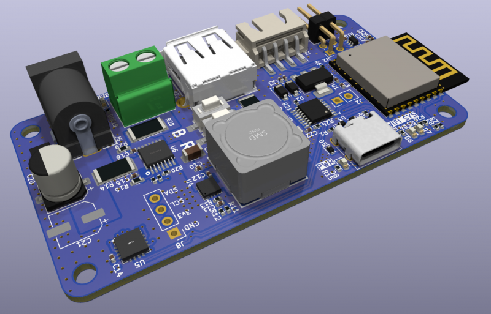

# ODROID Power Mate

A web-based remote power and monitoring tool for ODROID Single Board Computers (SBCs), powered by an ESP32-C3.

This project provides a comprehensive web interface to control power, monitor real-time metrics, and access the serial console of your ODROID from any web browser on your local network.



## Features

- **Web-Based UI**: Modern, responsive interface built with Bootstrap and vanilla JavaScript.
- **Power Control**: Independently toggle Main (e.g., 12V) and USB (5V) power supplies.
- **Power Actions**: Remotely trigger Reset and Power On/Off actions.
- **Real-time Metrics**: Monitor voltage, current, and power consumption with a live-updating graph.
- **Interactive Serial Terminal**: Access your ODROID's serial console directly from the web UI via WebSockets.
- **Wi-Fi Management**:
    - Scan and connect to Wi-Fi networks (STA mode).
    - Enable Access Point mode (AP+STA) to connect directly to the device.
    - Configure static IP settings.

## Prerequisites

Before you begin, ensure you have the following installed and configured on your system:

- **[ESP-IDF (Espressif IoT Development Framework)](https://docs.espressif.com/projects/esp-idf/en/latest/esp32c3/get-started/index.html)**: This project is developed and tested with ESP-IDF `v6.0.2`.
- **[Node.js and npm](https://nodejs.org/)**: Required to build the web application. Node.js LTS version (e.g., 18.x or later) is recommended.
- **[Nanopb](https://github.com/nanopb/nanopb)**: Required to build for protobuf.

### Install dependencies (Ubuntu)

```bash
sudo apt install nodejs npm nanopb
```

## How to Build and Flash

1.  **Clone the repository:**
    ```bash
    git clone https://github.com/hardkernel/odroid-powermate.git
    cd odroid-powermate
    ```
2.  **Set up the ESP-IDF environment:**
    Open a terminal and source the ESP-IDF export script. The path may vary depending on your installation location.
    ```bash
    . $HOME/esp/esp-idf/export.sh
    ```
3.  **(Optional) Configure the project:**
    You can configure project-specific settings, such as default Wi-Fi credentials, by running `menuconfig`.
    ```bash
    idf.py menuconfig
    ```

4.  **Build the project:**
    This command compiles the application, bootloader, partition table, and web page data.
    ```bash
    idf.py build
    ```

5.  **Flash the firmware:**
    Connect your `ODROID Power Mate` board to your computer and replace `/dev/ttyACM0` with your device's serial port.
    ```bash
    idf.py -p /dev/ttyACM0 flash
    ```

6.  **Monitor the output:**
    To view the serial logs from the device, use the `monitor` command. This is useful for finding the device's IP address after it connects to your Wi-Fi.
    ```bash
    idf.py -p /dev/ttyACM0 monitor
    ```
    To exit the monitor, press `Ctrl+]`.

    Otherwise, you can use minicom
    ```bash
    minicom -D /dev/ttyACM0 -b 115200
    ``` 

## Usage

1.  After flashing, the ESP32 will either connect to the pre-configured Wi-Fi network or start an Access Point (APSTA).
2.  Check the serial monitor logs to find the IP address assigned to the device in STA mode, or the default AP address (usually `192.168.4.1`).
3.  Open a web browser and navigate to the device's IP address.
4.  You should now see the ODROID Remote control panel.

## Examples

- [Power data logger](example/logger): Python script for logging data and plot
- [PMTUI](example/pmtui): Powermate frontend TUI application
- [Claude Code plugin](example/claude-plugin): MCP server and skill that let Claude control the attached SBC (power, UART console, boot logs, power measurement)

## Docs

- Hardkernel WiKi: [https://wiki.odroid.com/accessory/powermate](https://wiki.odroid.com/accessory/powermate)

## Repo

- Hardkernel Github: [https://github.com/hardkernel/odroid-powermate](https://github.com/hardkernel/odroid-powermate)
- Original Repo: [https://github.com/shinys000114/odroid-powermate](https://github.com/shinys000114/odroid-powermate)

## License

| Path | License |
|---|---|
| Firmware (`main/`, build files) | [GPL-3.0-only](LICENSE) |
| Web UI (`page/`) | [GPL-3.0-only](LICENSE) |
| Protobuf definition (`proto/`) | [Apache-2.0](proto/LICENSE) |
| Code generated from `proto/status.proto` (`main/proto/status.pb.*`, `page/src/proto.js`) | [Apache-2.0](proto/LICENSE) |
| Examples (`example/`) | [Apache-2.0](example/LICENSE) |

Source files carry an `SPDX-License-Identifier` header. The generated protobuf files are
rewritten on every build, so their license is declared in [REUSE.toml](REUSE.toml) instead.
