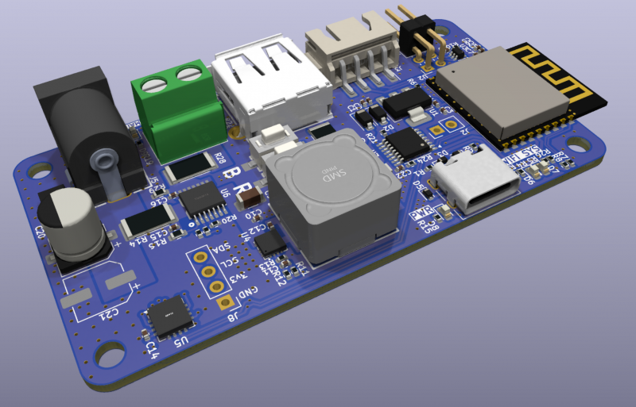

# ODROID Power Mate

A web-based remote power and monitoring tool for ODROID Single Board Computers (SBCs), powered by an ESP32-C3.

This project provides a comprehensive web interface to control power, monitor real-time metrics, and access the serial console of your ODROID from any web browser on your local network.



## Features

- **Web-Based UI**: Modern, responsive interface built with Bootstrap and vanilla JavaScript.
- **Power Control**: Independently toggle Main (e.g., 12V) and USB (5V) power supplies.
- **Power Actions**: Remotely trigger Reset and Power On/Off actions.
- **Real-time Metrics**: Monitor voltage, current, and power consumption with a live-updating graph.
- **Interactive Serial Terminal**: Access your ODROID's serial console directly from the web UI via WebSockets.
- **Wi-Fi Management**:
    - Scan and connect to Wi-Fi networks (STA mode).
    - Enable Access Point mode (AP+STA) to connect directly to the device.
    - Configure static IP settings.

## Prerequisites

Before you begin, ensure you have the following installed and configured on your system:

- **[ESP-IDF (Espressif IoT Development Framework)](https://docs.espressif.com/projects/esp-idf/en/latest/esp32c3/get-started/index.html)**: This project is developed and tested with ESP-IDF `v6.0.2`.
- **[Node.js and npm](https://nodejs.org/)**: Required to build the web application. Vite 7 needs Node.js 20.19+ or 22.12+ (`engines` in `page/package.json`). Ubuntu 24.04's `nodejs` package is 18.x, so install a newer one from [nodejs.org](https://nodejs.org/en/download) or NodeSource if npm warns `EBADENGINE`.
- **[Nanopb](https://github.com/nanopb/nanopb)**: Required to build for protobuf.

### Install dependencies (Ubuntu)

```bash
sudo apt install nodejs npm nanopb
```

## How to Build and Flash

1.  **Clone the repository:**
    ```bash
    git clone https://github.com/hardkernel/odroid-powermate.git
    cd odroid-powermate
    ```
2.  **Set up the ESP-IDF environment:**
    Open a terminal and source the ESP-IDF export script. The path may vary depending on your installation location.
    ```bash
    . $HOME/esp/esp-idf/export.sh
    ```
3.  **(Optional) Configure the project:**
    You can configure project-specific settings, such as default Wi-Fi credentials, by running `menuconfig`.
    ```bash
    idf.py menuconfig
    ```

4.  **Build the project:**
    This command compiles the application, bootloader, partition table, and web page data.
    ```bash
    idf.py build
    ```

5.  **Flash the firmware:**
    Connect your `ODROID Power Mate` board to your computer and replace `/dev/ttyACM0` with your device's serial port.
    ```bash
    idf.py -p /dev/ttyACM0 flash
    ```

6.  **Monitor the output:**
    To view the serial logs from the device, use the `monitor` command. This is useful for finding the device's IP address after it connects to your Wi-Fi.
    ```bash
    idf.py -p /dev/ttyACM0 monitor
    ```
    To exit the monitor, press `Ctrl+]`.

    Otherwise, you can use minicom
    ```bash
    minicom -D /dev/ttyACM0 -b 115200
    ``` 

## Usage

1.  After flashing, the ESP32 will either connect to the pre-configured Wi-Fi network or start an Access Point (APSTA).
2.  Check the serial monitor logs to find the IP address assigned to the device in STA mode, or the default AP address (usually `192.168.4.1`).
3.  Open a web browser and navigate to the device's IP address.
4.  You should now see the ODROID Remote control panel.

### HTTPS (optional)

The web UI is served over HTTP by default. To serve it over HTTPS, open **Settings > TLS**,
turn on **Serve the Web UI over HTTPS** and press **Apply**: the device reboots and answers at
`https://odroid-pm-xxxx.local/` (port 443). Requests to `http://` (port 80) are redirected to
`https://`. With HTTPS off, port 443 stays closed, so browsers that try HTTPS first fall back
to `http://`.

- On first boot the device creates a self-signed EC P-256 certificate for
  `odroid-pm-xxxx.local`, the setup AP address `192.168.4.1` and, when one is set, its static IP.
  Browsers warn about it once; compare the SHA-256 fingerprint the browser shows with the one in
  **Settings > TLS** before you accept it.
- **Create New Self-Signed Certificate** replaces it. **Install Your Own Certificate** takes a PEM
  certificate (optionally followed by intermediates) and its unencrypted EC P-256 or RSA-2048 key.
  EC is recommended: a new TLS connection takes ~0.7 s with EC and ~1.3 s with RSA on the ESP32-C3.
  A new certificate is served after the next reboot. Over plain HTTP the key is sent unencrypted,
  so upload it over HTTPS or on a trusted network.
- The certificate is kept in its own `tls` partition after the app, so firmware updates (including
  the merged `powermate-*.bin` image, which erases the settings) keep it. Erasing the whole flash
  removes it, and a new self-signed one is created.
- Over HTTPS the device serves 6 connections (10 over HTTP), TLS 1.2 only. If the certificate
  cannot be loaded the device falls back to HTTP; the TLS tab then says HTTPS did not start,
  and the USB debug log says why.
- If the web UI cannot be reached at all after changing HTTPS settings, holding the button for
  5 seconds resets all settings, HTTPS included (Wi-Fi too); the certificate is kept.
- The Claude plugin, pmtui and the logger follow the switch on their own (they ask the device without
  credentials whether it serves HTTPS) and accept the device's certificate as it is. Each can pin its
  SHA-256 fingerprint from Settings > TLS to refuse any other certificate; see their READMEs.
- Copying from the terminal (select, then Ctrl+C) uses the browser clipboard, which browsers only
  fully allow over HTTPS.

Making a certificate with OpenSSL (the Device tab shows these with the device's own names):

```bash
# Self-signed
openssl req -x509 -newkey ec -pkeyopt ec_paramgen_curve:P-256 -nodes \
  -keyout powermate.key -out powermate.crt -days 3650 \
  -subj "/CN=odroid-pm-xxxx" \
  -addext "subjectAltName=DNS:odroid-pm-xxxx.local,IP:192.168.1.50"

# Or signed by your own CA, so browsers that trust ca.crt do not warn
openssl req -x509 -newkey ec -pkeyopt ec_paramgen_curve:P-256 -nodes \
  -keyout ca.key -out ca.crt -days 3650 -subj "/CN=PowerMate Local CA"
openssl req -newkey ec -pkeyopt ec_paramgen_curve:P-256 -nodes \
  -keyout powermate.key -out powermate.csr -subj "/CN=odroid-pm-xxxx"
printf "subjectAltName=DNS:odroid-pm-xxxx.local,IP:192.168.1.50\nextendedKeyUsage=serverAuth\n" > powermate.ext
openssl x509 -req -in powermate.csr -CA ca.crt -CAkey ca.key -CAcreateserial \
  -days 825 -extfile powermate.ext -out powermate.crt
```

Upgrading a checkout: the HTTPS options live in `sdkconfig.defaults`, which an existing `sdkconfig`
does not pick up. The build stops with "delete sdkconfig and rebuild" until you do.

## Examples

- [Power data logger](example/logger): Python script for logging data and plot
- [PMTUI](example/pmtui): Powermate frontend TUI application
- [Claude Code plugin](example/claude-plugin): MCP server and skill that let Claude control the attached SBC (power, UART console, boot logs, power measurement)

## Docs

- Hardkernel WiKi: [https://wiki.odroid.com/accessory/powermate](https://wiki.odroid.com/accessory/powermate)

## Repo

- Hardkernel Github: [https://github.com/hardkernel/odroid-powermate](https://github.com/hardkernel/odroid-powermate)
- Original Repo: [https://github.com/shinys000114/odroid-powermate](https://github.com/shinys000114/odroid-powermate)

## License

| Path | License |
|---|---|
| Firmware (`main/`, build files) | [GPL-3.0-only](LICENSE) |
| Web UI (`page/`) | [GPL-3.0-only](LICENSE) |
| Protobuf definition (`proto/`) | [Apache-2.0](proto/LICENSE) |
| Code generated from `proto/status.proto` at build time | [Apache-2.0](proto/LICENSE) |
| Examples (`example/`) | [Apache-2.0](example/LICENSE) |

Source files carry an `SPDX-License-Identifier` header. Generated files (nanopb sources,
`proto.js`, the web bundle) are written to the build directory and are not checked in.
